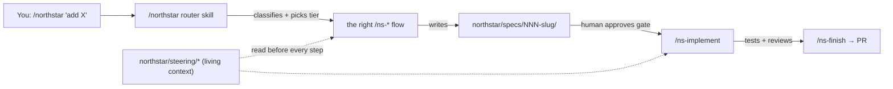
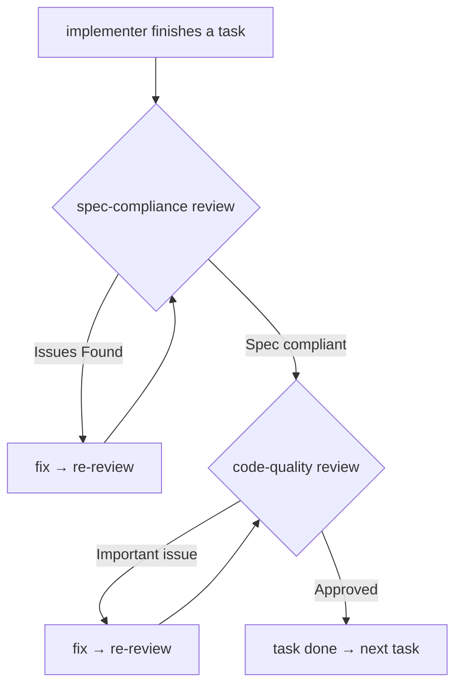
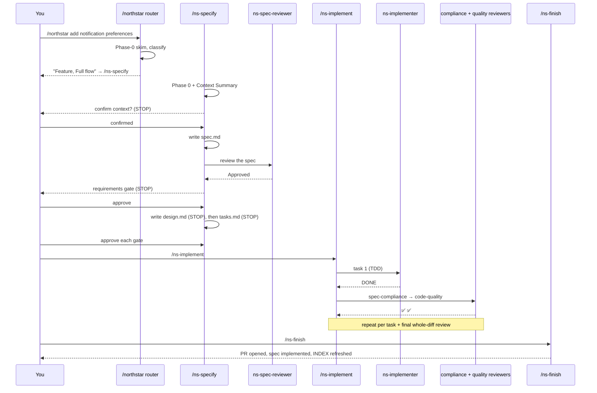

# SDD Developer Guide

This is the practical manual for engineers using the **Spec-Driven Development (SDD) kit** in
Cursor or Kiro. It assumes you've heard the term "spec-driven development" but have never used
*this* kit. By the end you should be able to install it, know exactly what every skill, agent,
hook, and rule does, and confidently run any kind of change — a feature, a bug, a refactor, a
migration, or onboarding a legacy repo — from first prompt to merged PR.

> **The one-sentence version:** type `/northstar`, describe what you want, and the kit walks you
> through a short, gated process that produces a reviewable *spec* before any code is written,
> then implements that spec with tests and automated reviews. The same flow works identically in
> Cursor and Kiro.

---

## Table of contents

1. [What you're installing (the mental model)](#1-what-youre-installing-the-mental-model)
2. [Installation & setup](#2-installation--setup)
3. [The directory layout after install](#3-the-directory-layout-after-install)
4. [The components, explained](#4-the-components-explained)
  - [4.1 Skills (the workflows you invoke)](#41-skills-the-workflows-you-invoke)
  - [4.2 Practice skills (techniques the flows lean on)](#42-practice-skills-techniques-the-flows-lean-on)
  - [4.3 Subagents (isolated workers & reviewers)](#43-subagents-isolated-workers--reviewers)
  - [4.4 Hooks (automation around the edges)](#44-hooks-automation-around-the-edges)
  - [4.5 Rules (always-on guardrails)](#45-rules-always-on-guardrails)
  - [4.6 The enforcement spine (scripts & CI)](#46-the-enforcement-spine-scripts--ci)
5. [The artifacts SDD produces](#5-the-artifacts-sdd-produces)
6. [End-to-end scenarios (with flows)](#6-end-to-end-scenarios-with-flows)
7. [The design decisions — and why they help you](#7-the-design-decisions--and-why-they-help-you)
8. [Tips](#8-tips)
9. [FAQ](#9-faq)

---

## 1. What you're installing (the mental model)

The kit is a set of **prompts, agents, and automation** that turn one habit — "describe the
change, get a spec, approve it, then build" — into something the IDE does *with* you. Three ideas
are worth holding in your head:

**a) There are two layers of documents.**

- **Living context** (`northstar/steering/`*) — a always-current description of the product, the tech
stack/conventions, and the code structure. The agent reads this before *every* change so it
matches your project instead of inventing things.
- **Increment specs** (`northstar/specs/NNN-slug/`) — one immutable folder per change. A spec records
*what* a change should do and *why*, in testable terms. You never rewrite an old spec; later
changes link back to it and update the living layer instead.

**b) Everything routes through `/northstar`.** You don't have to memorize which flow to use. You type
`/northstar`, describe the change, and it classifies the work and hands you off to the right flow at the
right "ceremony level" (a typo needs no spec; a migration needs the full treatment).

**c) The IDE folders are generated, not hand-written.** The *source of truth* lives in a single
`.northstar/` folder. The `.cursor/` and `.kiro/` folders are **adapters** built from it. That's what
makes the kit IDE-agnostic: an engineer can switch Cursor ↔ Kiro and lose nothing. (As an end
user installing a shipped bundle, you only ever see `.cursor/` and `.kiro/` — the `.northstar/` source
lives in the kit repo.)




---

## 2. Installation & setup

You only need **Python 3.8+** present for the local checks; the workflow itself needs no
dependencies. Pick the path for your IDE.

### 2.1 Cursor — two options

**Option A: the marketplace plugin (recommended for individuals).** Install the `northstar-kit` plugin
from the Cursor marketplace. It ships the skills, agents, rules, and hooks fully self-contained —
nothing is added to your repository. Trust the workspace and you're done; the skills appear as
`/northstar`, `/ns-specify`, etc.

**Option B: the in-repo bundle (recommended for teams who want the config pinned in git).** Drop a
self-contained `.cursor/` folder into the repo root using the installer below. This commits the
SDD config alongside your code so the whole team shares one pinned version.

### 2.2 Kiro — the in-repo bundle

Kiro uses the in-repo bundle: a self-contained `.kiro/` folder (skills, agents, and steering)
dropped into the repo root via the installer. Kiro hooks are then created once through Kiro's
**Agent Hooks** UI (see [4.4](#44-hooks-automation-around-the-edges)).

### 2.3 The `curl | sh` installer (drops `.cursor/` + `.kiro/` into a repo)

Run this **from your repository root** (the folder that contains `.git/`). It downloads a
checksum-verified release tarball and **merges** `.cursor/` and `.kiro/` into the current
directory:

```bash
cd /path/to/your/repo
curl -fsSL https://video-qa.phenompro.com/northstar/install.sh | sh
```

> **Host:** `video-qa.phenompro.com/northstar` is the current (temporary) host. The canonical host
> will be **`https://northstar.phenom.com/install.sh`** once DNS/CDN is configured — switch to it then.

What it does, in order:

1. Downloads `northstar-kit.tar.gz` (top level: `VERSION`, `.cursor/`, `.kiro/`).
2. Verifies its `sha256` against the published `.sha256` sidecar (refuses to install on mismatch).
3. Copies every file under `.cursor/` and `.kiro/` into your repo root.
4. For any file that already exists, it **overwrites** it but first saves a `.bak` copy (backups
  are on by default).
5. Prints the installed version, the count of new files, and the full list of overwritten files.

Useful flags (pass them through the pipe after `sh -s --`):


| Flag            | Effect                                    |
| --------------- | ----------------------------------------- |
| `--dry-run`     | Show what would change; write nothing.    |
| `--no-backup`   | Overwrite without saving `.bak` copies.   |
| `--force`       | Allow installing outside a git repo root. |
| `--skip-verify` | Skip the sha256 verification.             |
| `--url <url>`   | Override the tarball location.            |


```bash
# preview first, change nothing:
curl -fsSL https://video-qa.phenompro.com/northstar/install.sh | sh -s -- --dry-run
```

> The installer is intentionally strict about being at a git repo root — that's a guardrail so you
> don't accidentally scatter `.cursor/` and `.kiro/` into your home directory. `cd` into the repo
> first, or pass `--force` if you really mean to.

### 2.4 First-run sanity check

Open the repo in your IDE and type `/northstar`. If the router responds asking what you'd like to do,
you're set. If your repo is brand-new to SDD (no `northstar/steering/`), the natural first move is
`/ns-steer` (see scenario E).

---

## 3. The directory layout after install

```text
your-repo/
├── .cursor/                 # Cursor adapter (generated; self-contained)
│   ├── skills/              #   11 skills: /northstar, /ns-specify, … + practice skills
│   ├── agents/              #   5 subagents (reviewers + implementer)
│   ├── rules/               #   2 always-on/scoped rules
│   ├── hooks/               #   hook scripts (.sh)
│   └── hooks.json           #   hook wiring
├── .kiro/                   # Kiro adapter (generated; self-contained)
│   ├── skills/              #   same 11 skills
│   ├── agents/              #   same 5 subagents
│   └── steering/            #   constitution + product/tech/structure pointers
└── docs/
    ├── steering/            # Layer 1 — living context (you/the agent create these)
    │   ├── product.md
    │   ├── tech.md
    │   └── structure.md
    └── specs/               # Layer 2 — increment specs (created per change)
        ├── INDEX.md         #   the catalog the agent scans in Phase 0
        └── NNN-slug/        #   one folder per change
            ├── spec.md      #   (or bugfix.md / refactor.md)
            ├── design.md    #   (Full-tier only)
            └── tasks.md     #   (Full-tier only)
```

`northstar/steering/` and `northstar/specs/` are *your project's* content — they grow as you use the kit.
`.cursor/` and `.kiro/` are the installed machinery.

---

## 4. The components, explained

This is the heart of the guide. Every skill, agent, hook, and rule, with **what it is**, **why it
exists**, and **how you use it**.

### 4.1 Skills (the workflows you invoke)

A **skill** is a packaged workflow you trigger by name (`/ns-specify`) or that the agent invokes
for you. There are **7 workflow skills**. All of them begin with **Phase 0 context discovery** —
they read the steering files and any overlapping specs before doing anything, so they never act in
a vacuum.

#### `/northstar` — the router (the front door)

- **What:** A lightweight classifier. It reads just enough context to decide what kind of change
you're making and how much ceremony it deserves, then hands off to the right flow.
- **Why:** So you never have to remember the other six commands or argue with yourself about how
much process a change needs. It enforces constitution §7 — *match ceremony to risk* — so a typo
doesn't get a spec and a migration doesn't skip one.
- **How:** Type `/northstar` and describe the change in plain language. It replies with a one-line
classification + tier (e.g. *"Feature, Full flow — touches auth, medium blast-radius"*) and then
enters that flow automatically.
- **The tiers it picks:**

  | Tier          | Example                                  | What happens                                          |
  | ------------- | ---------------------------------------- | ----------------------------------------------------- |
  | **Exempt**    | typo, comment, dep bump, formatter       | No spec — it tells you to just make the change.       |
  | **Light**     | a bug, a small refactor                  | One document only (`bugfix.md` / `refactor.md`).      |
  | **Full**      | feature, migration, security, cross-team | Full gated flow: spec → (design → tasks) → implement. |
  | **Fast-path** | Sev-1 hotfix                             | Ship now; backfill a retro-spec within 24h.           |


#### `/ns-specify` — features, greenfield, performance, migrations

- **What:** Produces an **increment spec** (`spec.md`) with EARS requirements, and for higher-risk
work also `design.md` and `tasks.md`, each through its own approval gate.
- **Why:** This is the core "spec before code" flow. EARS (`WHEN/WHILE/IF/WHERE … THE SYSTEM SHALL …`) forces requirements to be unambiguous and testable, which is what makes later tests
and reviews objective rather than vibes.
- **How:** `/ns-specify add per-user notification preferences`. It will:
  1. Run Phase 0 and post a **Context Summary**, then *wait* for you to confirm.
  2. Ask clarifying questions one at a time only if something is genuinely ambiguous.
  3. Write `spec.md` to disk and run an automatic **spec review** (via the `ns-spec-reviewer`
    subagent) before showing it to you.
  4. **Stop at the requirements gate** for your approval.
  5. For Full-tier work only: write `design.md` (with mermaid diagrams where they help), stop for
    the design gate; then write `tasks.md` (a dependency-aware build plan), stop for the tasks
     gate.
- **Important:** it writes files to disk and reports a short diff — it does **not** dump the whole
spec into the chat, and it never writes implementation code.

#### `/ns-bug` — defects and regressions

- **What:** Produces a `bugfix.md` with a root-cause analysis and a **mandatory regression test**
that fails before the fix and passes after.
- **Why:** A bug fixed without a test that proves it's fixed tends to come back. Naming the *root
cause* (not the symptom) before proposing a fix is what prevents whack-a-mole patching.
- **How:** `/ns-bug checkout total is wrong when a coupon and tax both apply`. It finds the
spec/REQ that owns the broken behavior, works the root cause using the systematic-debugging
practice, writes `bugfix.md` (Light tier — single doc), and confirms the regression-test
scenario. The fix itself happens later in `/ns-implement`.

#### `/ns-refactor` — restructuring with no behavior change

- **What:** Produces a `refactor.md` with an **invariant matrix** — the observable behaviors that
must be identical before and after — each mapped to a test.
- **Why:** Refactors are dangerous precisely because they *shouldn't* change behavior. The
invariant matrix and a behavior-preservation test plan are your safety net.
- **How:** `/ns-refactor split the 800-line OrderService into smaller modules`. It first
*gate-checks* that no observable behavior changes (if it does, it sends you to `/ns-specify`),
then documents scope and invariants. If test coverage is thin, it lists characterization tests
to add *before* touching the code.

#### `/ns-steer` — onboard a repo / refresh living context

- **What:** Inspects your actual codebase and writes the three steering files
(`product.md`, `tech.md`, `structure.md`) into `northstar/steering/`.
- **Why:** Every other flow reads steering in Phase 0. Without it, the agent guesses your stack and
conventions. This is the first thing you run in a brownfield repo, and what you re-run when the
system changes enough that steering is stale.
- **How:** `/ns-steer`. It detects (does not invent) your stack, conventions, and module
boundaries from real files, writes the three files to disk, flags any places your codebase is
internally inconsistent, and **stops for you to review the diff and commit**. It deliberately
does not chain into another flow.

#### `/ns-implement` — build an approved spec

- **What:** Executes the approved spec. It works `tasks.md` in dependency order (or derives minimal
steps for light-flow), writing tests for each requirement, with automated reviews after each
task.
- **Why:** This is where the spec becomes code — under discipline. It refuses to run on an
unapproved spec, isolates work on a branch, picks execution mode by risk, and runs a two-stage
review on every task.
- **How:** `/ns-implement 001-notification-preferences`. Its sequence:
  1. **Pre-flight:** verify `approval_state: approved` (stop if pending); for Full-tier, verify
    `design.md` and `tasks.md` exist and are approved; re-read steering; create a branch (or
     worktree).
  2. **Pick execution mode:** *Autonomous* (run task → review → next, default for low/medium risk)
    or *Checkpointed* (pause after each task, default for high risk).
  3. **Tasks-review** (if a `tasks.md` exists) via the `ns-tasks-reviewer` subagent.
  4. **Execute each task** via the `ns-implementer` subagent using strict TDD. Independent tasks
    marked `[P]` may run in parallel.
  5. **Per-task two-stage review:** `ns-spec-compliance-reviewer` first, then
    `ns-code-quality-reviewer`.
  6. **Final whole-diff review** + a check that every REQ-ID has a passing test.
  7. Update the living layer if behavior changed; mark the spec `implemented`.

#### `/ns-finish` — wrap up and ship

- **What:** The closeout flow. Verifies everything is green, updates the record, and opens a PR.
- **Why:** It guarantees the loop actually closes: spec marked `implemented`, living layer current,
catalog refreshed, PR linked to the spec. It writes no feature code.
- **How:** `/ns-finish`. Its sequence: verify tests + reviews passed and local checks are green →
update the living layer and set the spec to `implemented` with a Changelog entry → regenerate
`northstar/specs/INDEX.md` → **ask you how to land it** (open a PR (default, Bitbucket/GitHub-aware),
merge directly, keep the branch, or discard) → clean up the git worktree if you used one.

### 4.2 Practice skills (techniques the flows lean on)

These **4 skills** are not full workflows — they're focused techniques the workflow skills invoke
at the right moment. You can also invoke them directly when you want that discipline. They exist as
named skills (rather than being buried in prose) so the behavior is explicit, consistent, and
reusable across IDEs.


| Skill                  | What it is                                                                                                                                    | When it's used                                                                                                                     |
| ---------------------- | --------------------------------------------------------------------------------------------------------------------------------------------- | ---------------------------------------------------------------------------------------------------------------------------------- |
| `ns-brainstorming`    | A low-friction clarification loop: one question at a time, multiple-choice preferred, 2–3 alternatives with a recommendation, scaled to risk. | `/ns-specify` (and others) before drafting, when intent or approach is unclear. Skipped entirely when the request is unambiguous. |
| `ns-tdd`              | The strict RED → GREEN → REFACTOR cycle: failing test first, watch it fail for the right reason, minimal code to pass, then refactor green.   | Inside `/ns-implement` for every task. "A REQ-ID without a test is not done."                                                     |
| `ns-debugging`        | A 4-phase root-cause method: reproduce → isolate → name the root cause → verify. Bans guess-and-check patching.                               | Inside `/ns-bug` to find the real cause before any fix is proposed.                                                               |
| `ns-receiving-review` | How to respond to review feedback with rigor: verify each point on merit, fix root causes, push back with evidence, don't agree reflexively.  | Whenever a flow acts on feedback from a reviewer subagent or a human.                                                              |


### 4.3 Subagents (isolated workers & reviewers)

A **subagent** runs in its own fresh context and reports back a structured result. There are
**5 subagents**: one that writes code and four that review. Running them in isolation is
deliberate — it keeps the main conversation lean and gives reviews genuine "fresh eyes" instead of
the author grading their own homework.

> In Cursor and Kiro (both support subagents) these run as real subagents. If an environment
> lacks subagents, the main agent performs the same checks inline using the same rubric — the
> *outcome* is identical, only the mechanism differs.

#### `ns-implementer` — the one writer

- **What:** Implements **exactly one task** from `tasks.md` with strict TDD, runs the tests,
commits, and reports a status. It does **not** review its own work or start other tasks.
- **Why:** One task per worker keeps changes small, reviewable, and parallelizable. The status
protocol below makes "I'm stuck" a first-class, visible outcome instead of a silent bad guess.
- **The 4-status protocol it reports:**
  - **DONE** — complete, tests green, committed.
  - **DONE_WITH_CONCERNS** — complete but it has real doubts (states them so they're resolved
  before review).
  - **NEEDS_CONTEXT** — can't proceed without info that wasn't provided (says exactly what).
  - **BLOCKED** — can't complete it (task too big, plan looks wrong, environment broken).
- **How you experience it:** `/ns-implement` dispatches it per task and handles the status for
you. You rarely invoke it directly.

#### The four reviewers (read-only)

These never modify code — they read the actual files/diffs and return a verdict in a fixed format.
They are **advisory** (they flag; the human decides) and **calibrated not to nitpick** — they
block only on real problems.


| Reviewer                       | Runs                                                            | Checks                                                                                                    | Verdict                                                  |
| ------------------------------ | --------------------------------------------------------------- | --------------------------------------------------------------------------------------------------------- | -------------------------------------------------------- |
| `ns-spec-reviewer`            | In `/ns-specify`, before the requirements gate                 | EARS form, unique testable REQ-IDs, scope, `amends`/`supersedes` linkage, NFRs                            | `Approved` / `Issues Found`                              |
| `ns-tasks-reviewer`           | In `/ns-implement`, before executing                           | Every REQ-ID covered by a task, dependencies declared, `[P]` marked, target files named                   | `Approved` / `Issues Found`                              |
| `ns-spec-compliance-reviewer` | After each task, **first** of the two                           | Does the code match the spec exactly — nothing missing, nothing extra, every acceptance criterion tested? | `Spec compliant` / `Issues Found`                        |
| `ns-code-quality-reviewer`    | After each task, **second**; and once over the whole final diff | Conventions, banned patterns, meaningful tests, clarity, robustness, security                             | `Approved` / `Issues Found` (blocks only on *Important*) |


The order is fixed and meaningful: **spec-compliance before code-quality.** There's no point
polishing code that builds the wrong thing.




### 4.4 Hooks (automation around the edges)

**Hooks** fire on IDE events to bring SDD feedback into the loop automatically. There are **3**.
They are an *accelerator, not the source of truth* — the real gate is always the check script in
CI. If you disabled every hook, SDD would still work; you'd just get feedback a little later.


| #   | Purpose                                                                 | Cursor                                        | Kiro                                                                                    |
| --- | ----------------------------------------------------------------------- | --------------------------------------------- | --------------------------------------------------------------------------------------- |
| 1   | Inject an SDD pointer into new sessions so the agent routes through SDD | `sessionStart` hook (`northstar-bootstrap.sh`)      | Prompt-Submit hook, or just rely on `.kiro/steering/northstar.md`                             |
| 2   | Run `northstar_check.py` after a turn and nudge to fix failures               | `stop` hook (`northstar-local-check.sh`)            | **Agent Stop** hook → `python3 scripts/northstar_check.py`                                    |
| 3   | Auto-advance a review loop when a reviewer finds issues                 | `subagentStop` hook (`northstar-review-advance.sh`) | Not available (Kiro hooks don't fire inside subagents) — the main-agent loop handles it |


- **Cursor:** already wired. `.cursor/hooks.json` references the three scripts in `.cursor/hooks/`.
No setup beyond trusting the workspace. The scripts must stay executable. One-off bypass of the
local check: `NORTHSTAR_SKIP=1`.
- **Kiro:** create hooks #1 and #2 once via the **Agent Hooks** panel
(`Cmd/Ctrl+Shift+P → Kiro: Open Kiro Hook UI`). Hook #3 isn't possible on Kiro and isn't needed —
it's purely a Cursor optimization on top of the portable prose loop the flows already run.

> **Why hook #3 being Cursor-only doesn't matter:** the review loops are *described in the flow
> prompts themselves*. The hook just makes Cursor advance them a beat faster. The behavior is the
> same on both IDEs.

### 4.5 Rules (always-on guardrails)

**Rules** are context the IDE keeps loaded so the agent follows your conventions without being
re-told. There are **2**.


| Rule                 | Scope                                         | What it does                                                                                                                                                                                                                                                        |
| -------------------- | --------------------------------------------- | ------------------------------------------------------------------------------------------------------------------------------------------------------------------------------------------------------------------------------------------------------------------- |
| `ns-constitution`   | Always on                                     | Loads the **Engineering Constitution** every session — the 13 non-negotiable principles (spec before code, EARS, two layers, approval gates, match ceremony to risk, tests prove the spec, etc.). This is the contract every flow and every PR is measured against. |
| `ns-spec-authoring` | Scoped to `northstar/specs/`**, `northstar/steering/**` | Detailed authoring rules that kick in only when editing specs/steering — front-matter contract, EARS rules, "increment specs are immutable," keep `INDEX.md` current, keep steering lean.                                                                           |


The constitution is short by design — principles, not procedures. It's worth reading once; it
explains *why* every flow behaves the way it does. The scoped authoring rule keeps always-on
context lean (constitution §13) by loading detail only when you're actually editing those files.

### 4.6 The enforcement spine (scripts & CI)

The IDE machinery makes SDD *pleasant*; these scripts make it *real*. They're plain Python (stdlib
only) so they run identically on your laptop, in a pre-commit hook, and in CI.


| Script                    | What it checks / does                                                                                                                                                                                                                                                                                     |
| ------------------------- | --------------------------------------------------------------------------------------------------------------------------------------------------------------------------------------------------------------------------------------------------------------------------------------------------------- |
| `scripts/northstar_check.py`    | The validator. (1) front-matter is complete and `spec_id` matches the folder, (2) every requirement is valid EARS, (3) every spec is in `INDEX.md` and vice-versa. Plus two soft checks: every REQ-ID of an *implemented* spec is referenced by a test, and steering files stay under the context budget. |
| `scripts/gen_index.py`    | Regenerates `northstar/specs/INDEX.md` from spec front-matter. `--check` mode verifies it's in sync.                                                                                                                                                                                                           |
| `scripts/gen_adapters.py` | (Kit-maintainer side) regenerates `.cursor/` and `.kiro/` from `.northstar/`. `--check` mode verifies they match.                                                                                                                                                                                               |


In CI (`bitbucket-pipelines.yml` / `.github/workflows/northstar.yml`) these run on every PR — that's the
deterministic backstop. **Org-wide metrics** (e.g. "% of PRs that have specs") are measured
centrally by your platform/ops team via the same check logic, so individual repos don't have to
wire anything up.

---

## 5. The artifacts SDD produces


| File                                                    | Created by                     | Mutable?              | Purpose                                                                   |
| ------------------------------------------------------- | ------------------------------ | --------------------- | ------------------------------------------------------------------------- |
| `northstar/steering/product.md` · `tech.md` · `structure.md` | `/ns-steer`                   | **Yes** (living)      | The always-current project context read in Phase 0 of every flow.         |
| `northstar/specs/NNN-slug/spec.md`                           | `/ns-specify`                 | No (except Changelog) | The increment spec: EARS requirements + acceptance criteria.              |
| `northstar/specs/NNN-slug/bugfix.md`                         | `/ns-bug`                     | No (except Changelog) | Root cause + regression-test plan for one bug.                            |
| `northstar/specs/NNN-slug/refactor.md`                       | `/ns-refactor`                | No (except Changelog) | Scope + invariant matrix for one refactor.                                |
| `northstar/specs/NNN-slug/design.md`                         | `/ns-specify` (Full-tier)     | No (except Changelog) | Chosen approach, architecture/data-flow (with mermaid), data/API changes. |
| `northstar/specs/NNN-slug/tasks.md`                          | `/ns-specify` (Full-tier)     | No (except Changelog) | Dependency-aware build plan; each task maps to REQ-IDs.                   |
| `northstar/specs/INDEX.md`                                   | `gen_index.py` / `/ns-finish` | Generated             | The catalog the agent scans to find relevant prior work.                  |


**The front-matter is a contract.** Each spec carries machine-readable fields — `touches` (code
globs that drive future Phase-0 discovery), `amends` / `supersedes_reqs` (links to prior behavior
this changes), `risk`, `blast_radius`, `compliance_tags`, `approval_state`. These aren't
decoration; they're what makes discovery, gating, and metrics work.

---

## 6. End-to-end scenarios (with flows)

Each scenario shows the exact sequence, what happens at each step, and who acts (you vs. the agent
vs. a subagent).

### Scenario A — A new feature (Full flow)

> *"Add per-user notification preferences."*




**Step-by-step:** route → Phase-0 Context Summary (stop) → draft spec → auto spec-review → fix &
re-review until approved → **requirements gate** (you approve) → design (stop) → tasks (stop) →
implement (tasks-review → per-task TDD + two-stage reviews → final review) → finish (PR).

### Scenario B — A bug fix (Light flow)

> *"Checkout total is wrong when a coupon and tax both apply."*

1. `/ns-bug …` → Phase 0 finds the spec/REQ that owns checkout totals.
2. Works the **root cause** (systematic-debugging) — does not propose a fix until the cause is
  named.
3. Writes `bugfix.md` with actual vs. expected, root cause, fix approach, and a **regression test
  scenario that fails now**.
4. You approve.
5. `/ns-implement` → writes the regression test (watch it fail) → fixes the root cause (watch it
  pass) → two-stage review.
6. `/ns-finish` → PR.

Note there's **no `design.md`/`tasks.md`** — bugs are Light tier, single doc.

### Scenario C — A refactor (Light flow, behavior-preserving)

> *"Split OrderService into smaller modules — no behavior change."*

1. `/ns-refactor …` → **gate check**: confirms no observable behavior changes (else → `/ns-specify`).
2. Writes `refactor.md` with the **invariant matrix** (behaviors that must stay identical, each
  mapped to a test). If coverage is thin, it lists **characterization tests to add first**.
3. You approve.
4. `/ns-implement` → adds any characterization tests **first**, then refactors, keeping all
  invariants green throughout.
5. `/ns-finish` → usually updates `structure.md` (organization changed) and opens a PR.

### Scenario D — A migration (Full flow, highest ceremony)

Same shape as Scenario A, but `risk: high` so it defaults to **Checkpointed** execution mode
(pause after each task), `design.md` must cover data contract + rollout + **rollback**, and the
spec flags backward-compatibility concerns explicitly. The gates matter most here — this is where
"30 minutes of spec review saves 30 days of rework" earns its keep.

### Scenario E — Brownfield onboarding (do this first on a legacy repo)

> *Repo has no `northstar/steering/` yet.*

1. `/ns-steer` → inspects the actual codebase, **detects** (doesn't invent) stack/conventions/
  structure.
2. Writes `product.md`, `tech.md`, `structure.md`, flags internal inconsistencies, and **stops**.
3. You review the diff and commit.
4. From now on, every `/northstar-`* flow loads this steering in Phase 0. Then proceed with A/B/C/D as
  normal.

### Scenario F — An exempt change

> *"Fix a typo in a comment."*

`/northstar` classifies it **Exempt** and tells you to just make the change — no spec, no ceremony. This
is a feature, not a gap: forcing process onto trivial changes is itself a constitution violation
(§7).

### Scenario G — A Sev-1 hotfix (Fast-path)

Ship the fix immediately. Then within 24 hours, backfill a retro-spec (`/ns-bug` or
`/ns-specify` after the fact) so the change is documented and audited. Speed when it counts;
accountability right after.

---

## 7. The design decisions — and why they help you

Understanding *why* the kit is shaped this way is what turns "following a process" into "trusting a
process."

- **A router (`/northstar`) instead of memorizing commands.** One entry point, zero decision fatigue, and
ceremony automatically matched to risk. You can still call any flow directly when you know what
you want.
- **Two layers (living context + immutable specs).** The living layer never lies about *today*;
the increment specs preserve *why each change happened*. You get current context **and** an audit
trail, without either one rotting the other.
- **EARS requirements.** Banning "fast/secure/easy/robust" and requiring `WHEN … SHALL …` with an
acceptance line means every requirement can become a test. Reviews become objective.
- **Approval gates.** Catching "we're building the wrong thing" at the requirements stage costs
minutes; catching it after implementation costs days. The gates are cheap insurance.
- **Subagents for review and implementation.** Fresh-eyes reviews (the author doesn't grade
themselves) and a lean main thread (heavy work happens in isolated contexts). The reviewers are
calibrated *not* to nitpick, so the process accelerates good work rather than bikeshedding it.
- **Two-stage review in a fixed order.** Spec-compliance before code-quality — never polish code
that solves the wrong problem.
- **Hooks accelerate; CI enforces.** You can tune or disable any IDE hook and SDD still holds,
because the deterministic gate is the check script in CI. No single point of failure.
- **IDE-agnostic by construction.** Canonical `.northstar/` source, generated `.cursor/` and `.kiro/`
adapters. Switch IDEs and lose nothing; the workflow, specs, and context travel with the repo.
- **Context is a budget.** Steering stays lean, detail loads only when relevant, descriptions are
one sentence. Quality is never the thing traded away — tokens are spent proportional to risk.

---

## 8. Tips

- **When in doubt, just type `/northstar`.** Let it classify. You don't have to pre-decide the tier.
- **Start a brownfield repo with `/ns-steer`.** Everything downstream is better when steering is
accurate. Re-run it whenever the system changes enough that steering feels stale.
- **Confirm the Context Summary carefully.** Phase 0 is where the agent's understanding is cheapest
to correct. A 10-second correction here saves a wrong spec later.
- **Review *designs*, not just diffs** (constitution §12). Push back on an approach you dislike at
the design gate, before code exists.
- **Trust the gates — don't rubber-stamp them.** The whole value is the human judgment at each
gate. Read the spec; approve deliberately.
- **Keep steering lean (~300 words/file).** `northstar_check.py` warns past 400. Push depth into
`northstar/specs/domains/`* or the increment specs, which load only when relevant.
- **Let bugs stay Light.** Don't manufacture a `design.md` for a one-line fix; that's an §7
violation. Conversely, don't push a security change through the light flow.
- **Use Checkpointed mode for risky work.** For high-risk specs, pausing after each task is the
default and a feature — use it.
- **Run the checks locally before pushing:** `python3 scripts/northstar_check.py` (and
`gen_index.py --check`). Green locally = green in CI.
- **Push back on reviewers with evidence.** Reviews are advisory. If a reviewer is wrong, the
`ns-receiving-review` discipline says cite a test or spec line and move on — don't comply
reflexively.
- **One feature per spec.** If a request is really two changes, split it. The kit will tell you
when it spots this.

---

## 9. FAQ

**Q: Do I have to write specs by hand?**
No. The flows draft the spec, design, and tasks for you from your description and the codebase.
Your job is to *direct and approve* — confirm context, answer the occasional clarifying question,
and approve (or correct) at each gate.

**Q: This sounds heavy. Is it slow for small changes?**
Only as heavy as the change warrants. `/northstar` matches ceremony to risk: typos are exempt (no spec),
bugs and small refactors are a single doc, and only genuinely high-stakes work gets the full
spec → design → tasks treatment. Forcing full ceremony onto a trivial change is explicitly against
the constitution.

**Q: What's the difference between `northstar/steering/` and `northstar/specs/`?**
`northstar/steering/` is *living* context — always describes the system as it is **today**, updated in
place. `northstar/specs/NNN-slug/` is an *immutable* record of **one change** — never rewritten. New
changes link back via `amends`/`supersedes_reqs` and update steering instead of editing old specs.

**Q: Will a new change update or overwrite my old specs?**
No. Increment specs are immutable except for their Changelog. A change that alters earlier behavior
creates a *new* spec that links to the old one (`amends`) and updates the living layer. You keep
the full history.

**Q: Does the same workflow really work the same in Cursor and Kiro?**
Yes — that's a core design goal. The commands, the flows, the specs, and the context are identical.
The only differences are mechanical: Cursor ships hooks pre-wired; on Kiro you create two hooks via
the UI, and one Cursor-only optimization hook (review auto-advance) is replaced by the same loop
running in the main agent. Outcomes are identical.

**Q: What if I disagree with a reviewer subagent?**
Reviewers are advisory — they flag, you decide. Use the `ns-receiving-review` approach: verify the
claim, fix it if it's right, or push back with evidence (a test, a spec line) if it's wrong. If you
and a reviewer deadlock across ~3 rounds, the flow surfaces it to you to decide.

**Q: Can I skip the spec and just code?**
For exempt/trivial changes, yes — that's expected. For anything significant, the constitution says
no, and CI will flag a behavior change that lands without a spec. The point isn't bureaucracy; it's
that the spec is the contract your implementation and tests are measured against.

**Q: I have a Sev-1 in production. Do I have to write a spec first?**
No. That's the Fast-path tier: ship the fix now, then backfill a retro-spec within 24 hours so it's
documented and audited.

**Q: What does `/ns-implement` need before it will run?**
An **approved** spec (`approval_state: approved`). For Full-tier work it also needs an approved
`design.md` and `tasks.md`. If those are missing it stops and routes you back to `/ns-specify`
rather than improvising a plan.

**Q: Why are some things "skills" and others "subagents"?**
Skills are workflows *you* (or the agent) invoke and that run in the main conversation. Subagents
run in their own isolated context and report back — used for the one implementer and the four
reviewers, so reviews get fresh eyes and the main thread stays lean.

**Q: Do I need to set up the metrics ("% of PRs with specs") in my repo?**
No. That's measured centrally by your platform/ops team using the same check logic. Individual
repos don't wire up anything for metrics.

**Q: How do I update the kit later?**
Re-run the installer (`curl … | sh`) from the repo root — it overwrites the installed files (saving
`.bak` copies) and prints what changed and the new version. Cursor plugin users update through the
marketplace.

**Q: The installer says "not a git repo root." Why?**
A safety guardrail so you don't scatter `.cursor/`/`.kiro/` into the wrong directory. `cd` into
your repository root (where `.git/` lives) and re-run, or pass `--force` if you truly want to
install in the current folder.

**Q: What actually runs in CI?**
`scripts/northstar_check.py` (front-matter validity, EARS form, INDEX sync, plus soft test-reference and
steering-budget checks) and the index/adapter sync checks. That's the deterministic gate; the IDE
hooks just bring the same feedback into your editor earlier.

**Q: Where do mermaid diagrams come from?**
The `design.md` (and some bug/refactor docs) include mermaid diagrams where they add clarity —
`flowchart`/`graph` for data flow, `sequenceDiagram` for multi-step interactions, `erDiagram` for
schema changes. They render in GitHub, Cursor, and Kiro. The agent won't force a diagram onto a
trivial design.