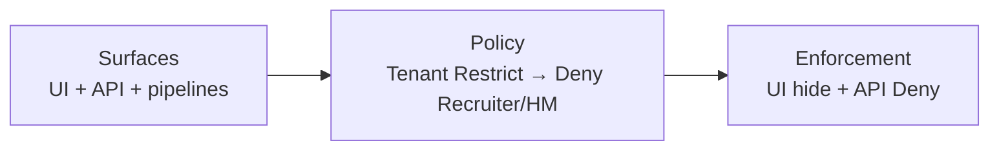

# Restrict Download & Export — Product Owner Explainer

**Audience:** CRM, HRM, Interview Intelligence, Scheduling, Messaging, Analytics, and Platform product owners  
**Related:** [`access-control-mbr-strategies.md`](access-control-mbr-strategies.md) · [FIRE-5458](https://phenompeople.atlassian.net/browse/FIRE-5458) · [PHEM-2267012](https://phenompeople.atlassian.net/browse/PHEM-2267012) · [CUSP-6718](https://phenompeople.atlassian.net/browse/CUSP-6718)  
**Evidence (visible tabs only):** [Platform Download Export Audit — Full Repo Scan(90 deep dive) 2026-08-05](https://docs.google.com/spreadsheets/d/11Q1q4ebzy5gv2JMV7kZ5y2-MXy3VdDyYt-sLyhXlL3U/edit?usp=sharing)  
**Status:** Working explainer · Aug 2026

### Spreadsheet tabs to use

| Tab | Use |
|-----|-----|
| **Executive Summary** | Verdict, scope, strategy |
| **Download/Export Capabilities Matrix** | Surfaces to **validate and update** (add missing user-facing / API / admin exports) |
| **Products Rollup** | Per-product count and AES-fit rollup |
| **Gaps** | Known control holes |
| **Implementation Strategy** | MVP checklist ∥ Restrict ∥ APIs → Wave 2 → light mapping → Hub/AES |
| **Legend** | Auth mechanism codes |
| **Apply-Tools Deep Dive** | Apply / RM / DEC / MCS / Chat / HCM / PHENIT detail |

---

## One-liner

Give customers (first: Allianz) a **single tenant Restrict** control so recruiters and hiring managers cannot download or export candidate data — enforced on **UI and APIs** (and Open API / async pipelines) — with Hub / AES as the later decision engine. **AES is the destination, not the Allianz critical path.**

---

## Scope of inventory (what belongs in the Capabilities Matrix)

**In scope**

- **User-facing** download/export (recruiter, HM, interviewer CTAs)  
- **API export/download** (same product backends + Open / public APIs that return files or bulk data)  
- **Admin exports** (tenant config, migration packs, etc.) — **include in the matrix** for completeness; Allianz MVP **may not need** recruiter Deny on these if they stay admin-only and authenticated  

**Out of scope for Restrict / matrix noise**

- Copy/paste, print, screenshots  
- Infra / test / “export const” code noise  
- Pure internal batch jobs with no user or external API consumer  

---

## Customer need (what “done” means)

Allianz DP wants recruiters and HMs unable to pull candidate data onto a laptop (documents, list exports, evaluation PDFs, dashboard downloads). They treat this as:

- a **go-live blocker for Interview Intelligence**, and  
- a **must-have (RUN) for CRM**.

**We promise:** in-scope download/export paths are turned off for those roles (button hidden + **API Deny** + pipelines/Open API Deny where in MVP).

**We do not promise:** data can never leave the system. Copy/paste, screenshots, and print still exist. Sell **risk reduction**, not absolute exfiltration.

---

## Mental model (three layers)



| Layer | Plain English | Who owns |
|-------|---------------|----------|
| **Surfaces** | Every user-facing or API path that produces a file / bulk export | Each product maps and maintains in Capabilities Matrix |
| **Policy** | For Allianz: **Deny** download/export for Recruiter/HM (admins exempt) | **One tenant Restrict setting now**; Hub / AES later |
| **Enforcement** | Before button, before API, before async enqueue/redeem, on Open API → “allowed?” | Each product (+ gateway for Open API) |

**What most products do today:** a mix of **Allow permissions** (e.g. `modules.*.export`), **local feature flags**, and sometimes **tenant config** — plus token/middleware checks that often do **not** assert a download/export Deny. Allianz needs **Deny wins** on existing personas (Recruiter/HM). We do **not** create a new recruiter role.

**Named actions** (`rx.data.export`, etc.) are a **light mapping exercise later** for Hub/AES standardization — **not** a day-one catalog project. Day one = **one Restrict kill-switch enforced on real APIs**.

---

## Cross-product note

CRM Restrict helps CRM surfaces. **II, Scheduling, HRM, and Open API paths still need their own Deny wiring** on UI and APIs — Restrict is shared policy, not an automatic cascade into every product.

---

## How it works today (near-term / Allianz)

1. **Tenant Restrict ON** (Phenom/CS enables for Allianz): “Restrict recruiter/HM download & export.”  
2. That means **Deny** for those personas on all **wired** MVP surfaces (not a new role).  
3. Each product **and** Open API / export pipelines:
   - **UI:** if Deny → do not show Download / Export.  
   - **API:** **apply Deny** — reject (do not rely on UI only).  
   - **Pipelines / links:** if Deny → do not enqueue async export and do not redeem email/S3 links.  
4. **Admin / break-glass** still allowed (agreed list). Machine/Open API clients need an **explicit exemption list** — not silent allow.  
5. Existing **allows** (`modules.*.export`, product FFs) lose when Restrict is on — **Deny overrides allow**.  
6. Out-of-scope stays out (copy/paste, etc.).

No AES required for Allianz to get value.

---

## How it fits the access control vision / migration

| When | What happens | Product work |
|------|--------------|--------------|
| **Now (Allianz MVP)** | MVP checklist ∥ Restrict setting ∥ Apply Deny on MVP APIs/pipelines | Wire MVP; validate **MVP matrix rows** in parallel (not a full-matrix gate) |
| **Soon after** | Light map wired surfaces → optional action IDs | Low effort naming — no redesign |
| **Wave 1** (Hub) | Same IDs / surfaces in Hub with labels | Little product change |
| **Wave 6** (AES) | Shared check becomes `AES.evaluate` | Swap the brain; **call sites stay** |

Strategy context: [`access-control-mbr-strategies.md`](access-control-mbr-strategies.md).

---

## MVP in scope vs out of scope

### Must ship for Allianz sign-off (MVP)

| Area | What we turn off |
|------|------------------|
| **CRM** | Candidate document / resume download (incl. attachment APIs); main candidate & job list exports; **`crm-export-data` + async email/S3 paths** |
| **Interview Intelligence** | Evaluation / scorecard download (**all** CTAs + APIs, including bulk); **no `internal/` auth bypass** |
| **Scheduling** | Activity Centre / Scheduling–Interviews–Events **dashboard CSV downloads** ([CUSP-6718](https://phenompeople.atlassian.net/browse/CUSP-6718) item #1) |
| **HRM** | Candidate document download for HMs / interviewers |

CRM + II + Scheduling should land in the **same release train** if II go-live / CUSP dashboard scope is the gate. **CRM-only is not done.**

### Explicitly out of MVP — post-MVP backlog (still track in matrix)

| Bucket | Examples | Suggested wave |
|--------|----------|----------------|
| **Remaining CRM exports** | Tags, referrals, event expenses, GDPR/privacy export + profile download, hiring workflow/template export, other [PHEM-2267012](https://phenompeople.atlassian.net/browse/PHEM-2267012) rows | Wave 2 (CRM) |
| **Messaging Open API exports** | Email / SMS / WhatsApp candidate opt-in bulk export | Wave 2 (Messaging + gateway) |
| **Analytics PDFs / reports** | Analytics page PDF API, download report toolbox CSV/XLSX, scheduled report email | Wave 2–3 (Analytics) |
| **Admin config exports** | Tenant config, env migration packs — **in matrix**; Allianz recruiter Restrict **may not need** these if admin-only + authenticated | Wave 2 harden auth |
| **Transcripts / recordings** | II recording/transcript download | Confirm with CS — MVP only if required; else written waiver |

Also out forever as absolute blocks: copy/paste, print, screenshots; sample import templates.

---

## Hardening (non-negotiable for MVP — or Deny is cosmetic)

**Apply Deny on APIs** (and pipelines). UI hide alone fails Allianz.

| Surface | Today (audit) | Required when Restrict is on |
|---------|---------------|------------------------------|
| **`crm-export-data` (Temporal pipeline)** | ~No auth at service boundary | **Must check Deny** before enqueue and before complete |
| **Async paths (email / S3 links)** | File → email or presigned URL | Block at **enqueue** and **redeem** |
| **II `internal/` download routes** | Auth filter skips `internal/` | **Must not bypass** Authorization / Deny |
| **Resume / attachment download services** | Caller-trust (e.g. apply-resume) | **Server Deny** + tenant path validation |
| **Existing `modules.*.export` / FFs** | UI allows / product FFs | **Deny overrides allow** |
| **Messaging / other Open APIs** | Often gateway-key only | **Apply Deny** for restricted personas; exemptions only via Platform list |

### Open API rule

1. Identify principal (user token, service account, API client).  
2. Restricted human persona (recruiter/HM) → **Deny**.  
3. Admin / approved system integration → allow only via **explicit exemption list**.  
4. Never assume “Open API = always allow export.”

### MVP QA checklist (ship blockers)

- [ ] CRM UI CTAs hidden under Restrict  
- [ ] CRM APIs reject under Restrict (`/exportData`, list export, attachment/resume)  
- [ ] **`crm-export-data`** Deny checked  
- [ ] **Async** enqueue + redeem blocked  
- [ ] II UI + PDF APIs Deny; **`internal/` cannot bypass**  
- [ ] Scheduling dashboard CSV Deny  
- [ ] HRM document download UI + API Deny  
- [ ] **Deny overrides** `modules.*.export` / FFs  
- [ ] Open API in MVP scope: Deny or documented exemption  

---

## Recommended execution strategy (order matters)

```
MVP checklist (matrix + CUSP / PHEM scope)
    ├──∥ Platform: Restrict setting + shared allow/deny check
    ├──∥ Products: Apply Deny on MVP APIs / pipelines
    └──∥ Products: Validate / fix MVP matrix rows only (add misses)
→ Allianz sign-off
→ Wave 2 (remaining CRM, Messaging Open API, Analytics, admin harden)
→ Full matrix hygiene continues in background (does not gate Allianz)
→ Light action mapping
→ Hub / AES
```

1. **MVP checklist** — freeze Allianz MVP surfaces (from Capabilities Matrix + CUSP/PHEM).  
2. **In parallel:**  
   - **Restrict** — Platform ships tenant Restrict + shared allow/deny check (no new role; no AES required).  
   - **APIs** — Products **apply Deny** on MVP UI + APIs + pipelines (CRM + `crm-export-data` + async + II incl. `internal/` + attachments + Scheduling + HRM).  
   - **Validate matrix (MVP only)** — confirm/correct MVP rows; add misses. Full-matrix validate does **not** block Restrict/API work.  
3. **Wave 2+** — remaining CRM exports, Messaging Open API, Analytics PDFs; harden admin export auth.  
4. **Light action-ID mapping** — optional naming for Hub/AES; FFs become aliases then retire from the customer story.  
5. **Hub / AES** — same call sites; decision engine swaps later.  

**Rule:** Matrix validation **supports** MVP wiring; it does **not** gate Restrict/API delivery. Do **not** burn eng on a full permission catalog before the kill-switch works on real APIs.

---

## Milestones

| Milestone | Customer / internal can say | Owner |
|-----------|----------------------------|-------|
| **M1** | MVP checklist agreed + honesty line | Platform PM + CS |
| **M2** | Restrict setting live ∥ CRM MVP APIs/pipelines Deny (`crm-export-data`, async, attachments) | CRM + Platform |
| **M3a** | II MVP Deny on II services; `internal/` bypass closed | II |
| **M3b** | Scheduling dashboard / Activity Centre CSV Deny | Scheduling |
| **M4** | HRM document download Deny | HRM |
| **M5** | MVP matrix rows validated (parallel — not a gate); Allianz sign-off path clear | Product teams |
| **M6** | Wave 2 backlog started (remaining CRM, Messaging Open API, Analytics) | Product + Platform |
| **M7** | Light mapping → Hub / AES | Platform — **not** Allianz go-live path |

---

## What each product owner needs to do

### All products

1. Confirm your **MVP checklist** rows in the Capabilities Matrix.  
2. **In parallel with Restrict:** wire **Deny on MVP APIs** (UI + pipelines) and **validate/fix those MVP rows** (add misses).  
3. Continue broader matrix hygiene in the background (user-facing + API + admin); do not block Allianz on full-matrix complete.  
4. **Deny overrides** existing allows/FFs when Restrict is on.  
5. QA with the hardening checklist.  
6. Each product wires its own surfaces — shared Restrict policy, local enforcement.

### CRM (RX)

- MVP: list exports + document/resume download + **`crm-export-data`** + async enqueue/redeem.  
- Wave 2: tags, referrals, event expenses, GDPR export, workflow template, other PHEM-2267012 rows.

### Interview Intelligence

- Wire Deny on **II services** (alongside CRM Restrict — not instead of product work). Close **`internal/`** bypass. FF = temporary alias only.  
- Confirm transcripts/recordings with CS.

### Scheduling

- MVP: dashboard / Activity Centre CSV — UI + API Deny; async redeem too.

### HRM

- MVP: candidate document download — UI + API.

### Messaging / Open API (Wave 2 unless pulled into MVP)

- Apply Deny on bulk opt-in export APIs; Platform-owned exemptions only.

### Analytics (Wave 2–3)

- PDF/CSV/XLSX + scheduled delivery under Restrict Deny when in wave.

### Platform

- Own Restrict setting, shared allow/deny check contract, admin + Open API exemption lists, later Hub/AES.  
- Own Deny-overrides-allow semantics.

---

## 30-second script (PO meeting)

> Allianz needs recruiters and HMs blocked from downloading or exporting candidate data. We’re shipping **one tenant Restrict** Deny — not a new role and not waiting on AES.  
> We run **in parallel:** Restrict setting, **Apply Deny on MVP APIs**, and validate MVP matrix rows. Full matrix cleanup continues but does not gate go-live.  
> Each product wires its own surfaces (CRM, II, Scheduling, HRM).  
> Later: Wave 2 residuals, then light action mapping, then Hub/AES on the same call sites.

---

## FAQ / expected pushback

| They say | You say |
|----------|---------|
| “We already have an export FF” | Alias for now; **Deny overrides** when Restrict is on. |
| “Do we create new permissions / roles?” | **No new role.** One Restrict Deny on existing personas. Action IDs = light mapping later. |
| “Can’t we just hide the button?” | No — **apply Deny on APIs** and async/Open API paths. |
| “When is AES?” | Not on the Allianz critical path. |
| “Does CRM Restrict cover II?” | Shared policy — II still wires Deny on its own UI/APIs. |
| “Open API is different” | Still produces files — **apply Deny** or explicit exemption. |
| “Tags / GDPR / Analytics / admin?” | Post-MVP unless DP pulls in; admin in matrix but **may not need** recruiter Restrict. |
| “Must the whole matrix be perfect first?” | No — **MVP rows** in parallel with Restrict/APIs; full matrix hygiene is background. |

---

## Success

1. Allianz DP signs off against the **MVP endpoint checklist**.  
2. Hardening rows pass (`crm-export-data`, async, II `internal/`, attachments, Deny-overrides-allow, Open API in scope).  
3. No “button still there” or “API/link still works” reopen within 30 days.  
4. Capabilities Matrix updated for user-facing + API (+ admin noted); post-MVP residuals tracked.  
5. Second tenant asks for same Restrict → platform pattern validated.

---

## Traceability

| Artifact | Role |
|----------|------|
| [Platform Download Export Audit — Full Repo Scan(90 deep dive) 2026-08-05](https://docs.google.com/spreadsheets/d/11Q1q4ebzy5gv2JMV7kZ5y2-MXy3VdDyYt-sLyhXlL3U/edit?usp=sharing) | Visible tabs listed at top |
| [CUSP-6718](https://phenompeople.atlassian.net/browse/CUSP-6718) | Customer feedback (CRM + HRM + dashboards + eval PDFs) |
| [PHEM-2267012](https://phenompeople.atlassian.net/browse/PHEM-2267012) | CRM surface inventory |
| [SUP-120556](https://phenompeople.atlassian.net/browse/SUP-120556) | CRM/HRM document download |
| [SUP-122338](https://phenompeople.atlassian.net/browse/SUP-122338) / [PHEM-1566689](https://phenompeople.atlassian.net/browse/PHEM-1566689) | II evaluation download FF path |
| [FIRE-5458](https://phenompeople.atlassian.net/browse/FIRE-5458) | Unified access vision |
| Slack `#restrict-downloads-and-export-of-data-in-crm` | Working channel |
