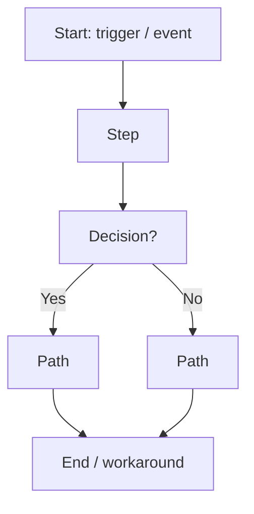
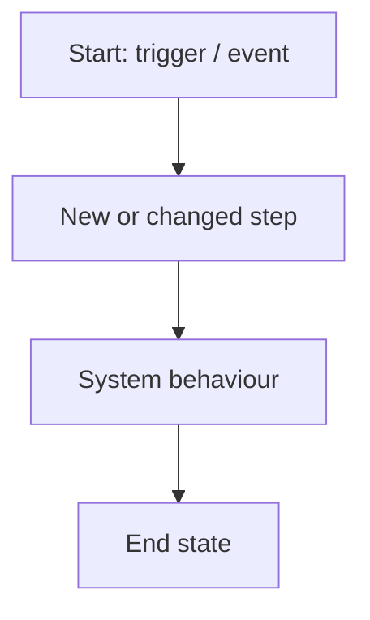
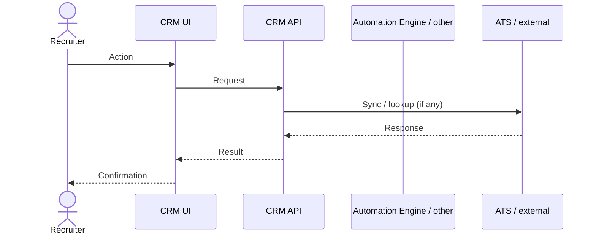
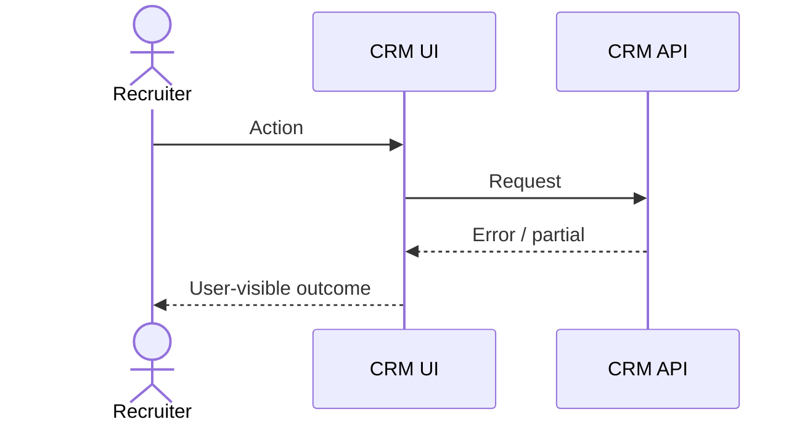
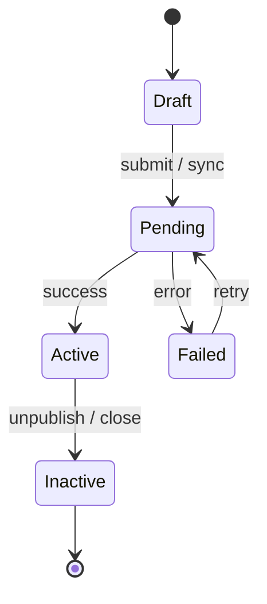

# SA Template — Phenom CRM Customer Development Ask

> **Audience:** Solution Architects (and CS/PS) handing a customer development ask to CRM Product / Engineering  
> **Not for:** Speculative feedback (use CUSP), or PM FRD authoring (use SpecDrivenDev FRD after this pack is complete)  
> **Output of this pack:** A complete, evidence-based requirements package PM can turn into an FRD / Epic / Stories without re-discovering the customer

---

## Why this template exists

Local repos already define **how PM writes product specs** — they do **not** define an SA intake pack with workflows and diagrams.

| Existing artifact (do not reinvent) | Location | What it covers |
|---|---|---|
| FRD Parts A–D | `phenom_repo/SpecDrivenDev/templates/frd-template.md` | PM functional requirements after problem breakdown |
| Epic description | `policies/templates/epic.md` | What / Why / Success / FRs by impact area / dependencies |
| Story description | `policies/templates/story.md` | User story + Given/When/Then AC |
| Platform routing | `policies/platform-routing.md` | Which platform pods to flag early |
| Product feedback (CUSP) | `skills/product-feedback.md` | Feedback tickets — **not** implementation commits |

**This template is new.** It sits **upstream** of the FRD: SA captures customer truth (problem, workflows, interactions, states). PM then authors FRD Part A–D from it.

Diagram sections (workflow / sequence / state) are **required here** because no local SA or FRD template currently mandates them.

---

## How to use (stage gate)

Fill stages **in order**. Do not skip to solution design before Stage 2 is done. Each stage has an **Objective** — if you cannot meet it, stop and get clarity from the customer before continuing.

| Stage | Name | Objective |
|------:|------|-----------|
| 0 | Cover sheet | Identify who, which tenant, which CRM surface, and the ask type |
| 1 | Problem & evidence | Separate customer problem from any proposed solution |
| 2 | Requirements | Capture stated asks with sources (no invented needs unmarked) |
| 3 | Workflows | Show as-is vs to-be business process end-to-end |
| 4 | Interaction diagrams | Show system/actor message flow for the critical path |
| 5 | State diagrams | Show entity lifecycle and allowed transitions |
| 6 | Data, integrations, constraints | Make FE/BE and Integration Experience implications explicit |
| 7 | Acceptance scenarios | Give PM/QA testable Given/When/Then seeds |
| 8 | Scope, risks, open questions | Prevent silent assumptions entering development |
| 9 | Handoff checklist | Confirm package is ready for PM → FRD / Epic |

**Minimum bar for handoff:** Stages 0–5 and 8–9 complete. Stages 6–7 may be partial if marked `[unconfirmed]` with an owner.

---

# Stage 0 — Cover sheet

**Objective:** Anyone opening this doc knows the customer, CRM product area, urgency, and links without reading further.

| Field | Value |
|-------|-------|
| **Document title** | SA-REQ — [Customer] — [Short ask] — YYYY-MM-DD |
| **Status** | Draft \| Customer-validated \| Ready for PM \| Parked |
| **Customer / account** | |
| **Tenant / env** | Prod ref / Staging ref |
| **Primary CRM product** | CRM - Core \| CRM - Profile \| CRM - Messaging \| CRM - Automation \| other (name) |
| **Ask type** | New capability \| Config gap \| Integration change \| Defect with product change \| Commit / residual from implementation |
| **Not CUSP feedback?** | Yes — this is a development / commit ask (if unsure, pause and check `skills/product-feedback.md`) |
| **SA author** | |
| **Customer sponsor** | Name + role |
| **Phenom PM (CRM)** | |
| **Related tickets** | SUP-… / CUSP-… / customer project / PHEM-… |
| **Source links** | Call notes, decks, SOW, emails (read-only list) |
| **Target go-live (customer)** | |
| **Last updated** | YYYY-MM-DD |

### CRM Core capability map (tick all touched)

Use the CRM Core areas from SpecDrivenDev (`crm-core-product` / skill guidance):

- [ ] Pipeline
- [ ] Sourcing / talent pools
- [ ] Requisitions / jobs
- [ ] Communication (from CRM)
- [ ] Organization (tags, filters, views)
- [ ] Automation (CRM-side)
- [ ] Evaluation / scorecards
- [ ] Other: ________

### Platform flags (scan `policies/platform-routing.md`)

| Capability keyword in this ask? | Platform team to engage early |
|---------------------------------|-------------------------------|
| Auto-advance / triggers / recipes | Automation Engine |
| Email / SMS / templates | Notifications / Messaging |
| ATS sync / Workday / SF | Integration Experience |
| Reports / exports / Snowflake | Talent Analytics |
| Tenant toggle / feature flag | Platform Config |
| Candidate-facing UI | Unified Candidate Experience |
| Scheduling / calendar | Scheduling Platform |

---

# Stage 1 — Problem & evidence

**Objective:** Document **only** the customer problem and impact. No Phenom solution yet. (Aligns with FRD Part A segregation.)

## 1.1 Background

- Customer recruiting model (high-volume, agency, campus, etc.):
- Why this matters **now**:

## 1.2 Current pain (cite sources)

| # | Pain | Who feels it | Frequency / volume | Source (ticket, call, email) |
|---|------|--------------|--------------------|------------------------------|
| 1 | | | | |
| 2 | | | | |

## 1.3 Business impact

| Dimension | Impact if unsolved |
|-----------|--------------------|
| Efficiency | |
| Compliance / risk | |
| Revenue / retention | |
| Candidate / HM experience | |

## 1.4 Personas affected

| Persona | What breaks for them today |
|---------|----------------------------|
| Recruiter | |
| Recruiting Ops / Admin | |
| Hiring Manager | |
| Candidate | |
| Agency / other | |

> **Gate:** Stage 1 is done when every pain row has a source, and no solution language appears in this stage.

---

# Stage 2 — Requirements (customer language)

**Objective:** Capture what the customer is asking for, tagged as stated vs inferred. (Maps to FRD Part A “What the Customer Is Asking For”.)

| # | Customer ask (their words) | Type | Related pain # | Source | Must-have / Nice |
|---|----------------------------|------|----------------|--------|------------------|
| 1 | "…" | Stated requirement | 1 | | Must |
| 2 | "…" | Explicit request \| Inferred need \| Constraint \| Question | | | |

**Types (from FRD template):** `Stated requirement` | `Explicit request` | `Inferred need` | `Constraint` | `Question`

### Related problems (cluster)

| # | Related problem (not the fix) | How it connects | Source |
|---|-------------------------------|-----------------|--------|
| 1 | | | |

> **Gate:** Stage 2 is done when every Must-have ask is Stated or Explicit with a source. Mark inferences as `Inferred need` — do not present them as customer quotes.

---

# Stage 3 — Workflows

**Objective:** Make the end-to-end business process visible so engineering does not invent steps. Both **as-is** and **to-be** are required.

## 3.1 Actors

| Actor | System or human? | Role in this flow |
|-------|------------------|-------------------|
| | | |

## 3.2 As-is workflow

**Objective of this diagram:** Show how work happens today, including manual workarounds.

**Narrative (bullets):**
1.
2.

## 3.3 To-be workflow

**Objective of this diagram:** Show the desired happy path after the change. Highlight new / changed steps.

**Narrative (bullets):**
1.
2.

## 3.4 Alternate / exception paths

| Path | Trigger | Expected handling |
|------|---------|-------------------|
| Error / timeout | | |
| Permission denied | | |
| Partial data from ATS | | |
| Rollback / undo | | |

> **Gate:** Stage 3 is done when as-is and to-be both run from trigger → terminal state, and exceptions are listed (even if “TBD with customer”).

---

# Stage 4 — Interaction diagrams

**Objective:** Show **who talks to whom** on the critical path (recruiter UI, CRM services, Automation Engine, Messaging, ATS, etc.). This is for FE/BE and integration scoping — not a full architecture design.

Use one sequence diagram per critical use case (copy the block).

## 4.1 UC-1: [Name] — happy path

**Objective of this diagram:** Sequence of calls/events for the primary Must-have ask.

## 4.2 UC-n: [Name] — failure / edge

### Interaction notes

| Step | Sync / async | Idempotent? | Retry / timeout expectation |
|------|--------------|-------------|-----------------------------|
| | | | |

> **Gate:** Stage 4 is done when every Must-have ask from Stage 2 has at least one sequence covering the happy path.

---

# Stage 5 — State diagrams

**Objective:** Define entity lifecycle so product and eng agree on allowed transitions (jobs, candidates, applications, automations, etc.).

## 5.1 Entity: [e.g. Job posting / Application / Recipe run]

**Objective of this diagram:** Legal states and transitions; note who/what may cause each transition.

### Transition table

| From | To | Trigger | Actor / system | Guards / conditions | Side effects |
|------|----|---------|----------------|---------------------|--------------|
| | | | | | |

### Illegal / out-of-scope transitions

- …

> **Gate:** Stage 5 is done when every state that appears in the to-be workflow has a transition row, and forbidden transitions are explicit.

---

# Stage 6 — Data, integrations, constraints

**Objective:** Surface FE/BE and Integration Experience implications early (feeds Epic “Platform Considerations” and Cross-Team Dependencies).

## 6.1 Data / fields

| Field / attribute | Source of truth | Create / Read / Update | Validation | Notes |
|-------------------|-----------------|------------------------|------------|-------|
| | CRM \| ATS \| other | | | |

## 6.2 Integrations

| System | Direction | Event / API | Owner pod (proposed) | Confirmed? |
|--------|-----------|-------------|----------------------|------------|
| | In / Out / Bi | | Integration Experience / … | Yes / No |

## 6.3 Non-functional (customer-stated or inferred)

| Category | Requirement | Type | Source |
|----------|-------------|------|--------|
| Volume / scale | | Stated / Inferred | |
| Latency | | | |
| Permissions / roles | | | |
| Localization / languages | | | |
| Audit / compliance | | | |

## 6.4 Constraints & non-negotiables

- …
- Must use existing platform capability where applicable (see Stage 0 platform flags) — do not propose custom one-off automation if Automation Engine applies.

> **Gate:** Stage 6 may be partial. Anything unconfirmed stays in Open Questions with an owner.

---

# Stage 7 — Acceptance scenarios (seeds for Stories)

**Objective:** Give PM/QA executable seeds in the same shape as `policies/templates/story.md` (Given / When / Then). SA does not need full Jira Stories — PM will expand into FRD Part C.

For each Must-have ask, provide **3–5** scenarios:

### Ask #1 — Scenario pack

**Scenario 1: [Name]**
- Given …
- When …
- Then …

**Scenario 2: [Name]**
- Given …
- When …
- Then …

**Scenario 3: [Name]**
- Given …
- When …
- Then …

> **Gate:** Stage 7 is done when each Must-have ask has ≥3 scenarios a tester could run without reading call notes.

---

# Stage 8 — Scope, risks, open questions

**Objective:** Prevent scope creep and silent assumptions (maps to Epic Out of Scope + Open Questions).

## 8.1 In scope (this delivery)

1.

## 8.2 Explicitly out of scope

| Item | Why out | Follow-up vehicle (Phase 2 / CUSP / other) |
|------|---------|-------------------------------------------|
| | | |

## 8.3 Assumptions

| # | Assumption | If false, what breaks? | Owner to validate |
|---|------------|------------------------|-------------------|
| 1 | | | |

## 8.4 Risks

| Risk | Likelihood | Impact | Mitigation |
|------|------------|--------|------------|
| | | | |

## 8.5 Open questions

| Question | Owner | Needed by | Status |
|----------|-------|-----------|--------|
| | | | Open |

> **Gate:** Stage 8 is done when every assumption is owned, and no Open question blocks Stage 9 without an explicit “accept risk” note from PM/SA.

---

# Stage 9 — Handoff checklist (SA → PM)

**Objective:** Confirm this package is enough for PM to start FRD Part A without rediscovery.

- [ ] Stage 0 cover sheet complete; ask type is **not** mis-filed CUSP feedback
- [ ] Stage 1 has no solution language; every pain has a source
- [ ] Stage 2 Must-haves are Stated/Explicit with sources; inferences labelled
- [ ] Stage 3 as-is + to-be workflows + exceptions
- [ ] Stage 4 sequence diagram(s) for every Must-have
- [ ] Stage 5 state diagram + transition table for primary entity
- [ ] Stage 6 integrations / platform flags reviewed against `platform-routing.md`
- [ ] Stage 7 ≥3 Given/When/Then scenarios per Must-have
- [ ] Stage 8 out of scope, assumptions, open questions owned
- [ ] Customer sponsor has validated Stages 1–3 (or gaps listed)
- [ ] Linked tickets listed; PM named

### Suggested next step for PM (do not skip SpecDrivenDev rules)

1. Ingest this pack as a **Source Input** in FRD Part A (`frd-template.md`)
2. Map Stage 2 → FRD “What the Customer Is Asking For”
3. Author FRD Parts B–D / Epic / Stories using `epic.md` + `story.md`
4. Keep this SA pack read-only after handoff; revise via versioned update, not silent edits

**Handoff sign-off**

| Role | Name | Date | Notes |
|------|------|------|-------|
| SA | | | |
| Customer sponsor | | | |
| CRM PM | | | |

---

## Appendix A — Mapping to existing Phenom templates

| This SA stage | Feeds into |
|---------------|------------|
| 0 Cover | Epic metadata; FRD header |
| 1 Problem | FRD Part A Customer Issue |
| 2 Requirements | FRD Part A Problem Breakdown / Customer asks |
| 3 Workflows | FRD Part B Solution Overview (after PM designs); Epic What |
| 4 Interactions | Epic Technical / Platform Considerations; Story Technical Notes |
| 5 States | Epic Functional Requirements (impact areas); Story AC |
| 6 Data / integrations | Epic Cross-Team Dependencies; `platform-routing.md` |
| 7 Acceptance | Story Acceptance Criteria; FRD Part C |
| 8 Scope / questions | Epic Out of Scope + Open Questions; FRD Part D |
| 9 Handoff | Start SpecDrivenDev create-prd workflow |

## Appendix B — What this template deliberately does not include

- Full FRD Part B/C solution authorship (PM / SpecDrivenDev)
- Jira field IDs or create/edit steps (`skills/jira-api.md`)
- CUSP external customer message templates (`skills/product-feedback.md`)
- Engineering code feasibility (use `skills/engineering-feasibility.md` after PM scopes)
